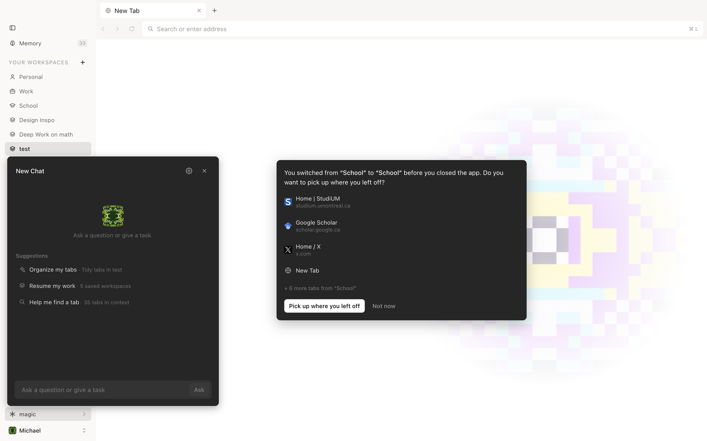
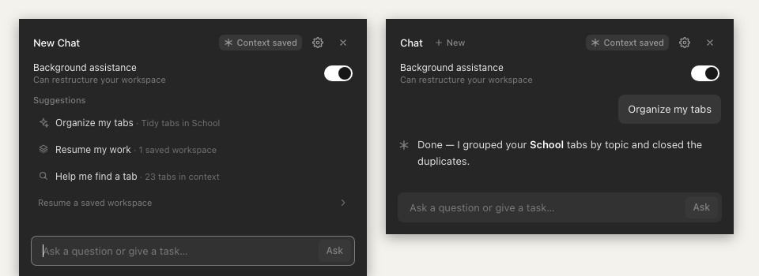

# Magic

A lightweight, intent-driven browser that adapts to what you're working on.



An AI agent understands your browsing context, automatically organizes your tabs, and keeps a recoverable workspace for each activity. Switching between studying, coding, and research becomes as seamless as switching between apps — without ever losing your place.

## The idea

Most browsers organize tabs. Magic organizes *activities*.

Each workspace has a name and a goal — "Study for finals," "Ship the launch," "Plan the trip" — and remembers exactly which tabs belong to it. Open a workspace and its tabs come back, just as you left them. Wander into something else, and Magic notices, tidies up, and keeps a checkpoint so you can return to any earlier moment from Memory.



## Design & engineering decisions

- **The workspace, not the tab, is the basic unit.** Tabs are grouped by what you're trying to do, and each workspace saves its own tab set. Switching replaces the open tabs with the target workspace's — never a merge — so each activity stays clean and predictable (`core/workspaces/switchboard.ts:52`).
- **Nothing is lost by design.** Before the agent reorganizes anything, the current tabs are saved as a restorable checkpoint (`core/memory/state.ts:107`). Workspaces, tabs, and switch history are stored locally in SQLite, so everything survives a restart (`main/db/workspace-db.ts:136`).
- **The agent helps, but never blocks you.** It works in the background and can be paused; if it's unavailable, switching workspaces still works. You can exclude specific sites or workspaces, and excluded tabs are never shown to the agent (`main/agent/host.ts:113`).
- **Parts are kept small and replaceable.** Browsing, workspaces, memory, and the agent are separate pieces with narrow connections between them. The agent's tools don't depend on a particular AI model or framework, so either can be swapped without rebuilding the browser (`agent/lib/tools/ports.ts:1`, `agent/README.md:98`).

## Download

Grab the latest build for your platform from [Releases](https://github.com/michaelzoub/magic/releases/latest):

| Platform | File |
| --- | --- |
| macOS (Apple silicon) | `Magic-x.y.z-mac-arm64.dmg` |
| macOS (Intel) | `Magic-x.y.z-mac-x64.dmg` |
| Windows | `Magic-x.y.z-win-x64.exe` |
| Linux | `Magic-x.y.z-linux-x86_64.AppImage` or `.deb` |

On first launch, open **Settings** (your avatar at the bottom of the sidebar) and paste a Meta Model API key from [dev.meta.ai](https://dev.meta.ai). The key is encrypted with your system keychain and stays on your device. Browsing and workspaces work without a key; the agent turns on once one is set.

> **macOS:** builds are not yet notarized, so macOS may say Magic "is damaged" or "can't be opened". Right-click the app and choose **Open**, or run `xattr -cr /Applications/Magic.app` once.

## Run from source

Requires Node 24+.

```bash
git clone https://github.com/michaelzoub/magic.git && cd magic
npm install
cp .env.example .env   # then set MODEL_API_KEY (or add the key in Settings later)
npm run dev
```

A `MODEL_API_KEY` in `.env` or your shell takes precedence over a key saved in Settings.

## For developers

```bash
npm run dev        # run the app
npm test           # run tests
npm run typecheck  # check types
npm run dist       # build an installer for this platform into dist/
```

Source layout: `main/` (Electron shell), `renderer/` (UI), `core/` (workspaces, memory, onboarding — no UI or Electron), `agent/` (the AI agent), `shared/` (contracts between processes). See `agent/README.md` for how the agent is wired.

### Releasing

Bump `version` in `package.json`, then push a tag:

```bash
git tag v0.1.0 && git push origin v0.1.0
```

`.github/workflows/release.yml` builds macOS, Windows and Linux installers and attaches them to a draft release. Review the draft, then publish it. In the packaged app, the agent runs as a prebuilt Eve server (`npm run build:agent`) shipped in the app's resources, and its state lives in the user's app-data folder.

To sign and notarize the macOS build, add the `CSC_LINK`, `CSC_KEY_PASSWORD`, `APPLE_ID`, `APPLE_APP_SPECIFIC_PASSWORD` and `APPLE_TEAM_ID` repository secrets (this needs an Apple Developer account) and set `notarize: true` in `electron-builder.yml`.
